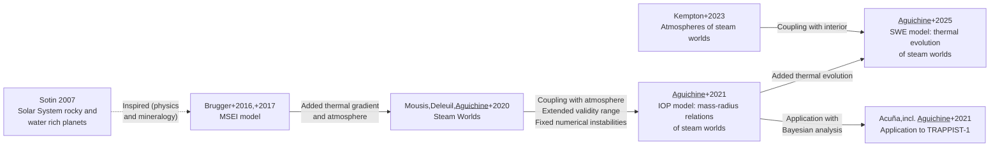

I uses structure models to connect observable properties of planets (mass, radius, temperature, age, etc.) to their bulk composition. My research focuses on **steam worlds**: water-rich planets whose intense stellar irradiation produces a steam atmosphere above (runaway greenhouse effect), and a deep water envelope in supercritical state (and other exotic phases of water: plasma, superionic, high pressure ices, etc.).

  

  Artist's impression of steam worlds's layered interior, shown in an exploded view. Illustration: <a href="https://www.quantamagazine.org/black-hot-superionic-ice-may-be-natures-most-common-form-of-water-20190508/">@iammoteh for Quanta Magazine</a>.

## Model development

These models have developed through a series of collaborations, for the immediate purpose of interpreting data from new space missions such as Kepler, Gaia, TESS, JWST and in the near future PLATO and ARIEL. The diagram below traces these developments and the connections between models.

<!-- Edit the quoted labels to change model names and researchers.
     Use the box IDs to edit connections; disable Mermaid lines with %% comments. -->

Solid arrows show direct extensions; dashed arrows show influence. Acronyms and references at the bottom of the page.

## Thermal evolution of steam worlds

My **Irradiated Ocean Planets (IOP)** model explored how hot water envelopes and steam atmospheres shape planetary mass–radius relationships . In previous studies, water worlds were often thought as objects with extended oceans of condensed water: liquid or high pressure ice. This model showed that steam worlds have much larger radii, making them great candidates to explain the radii of hundreds of sub-Neptunes found with Kepler.

A planet's radius depends on its thermal history as well as its composition. In the **Steam World Evolution (SWE)** model, my collaborators and I couple an interior model, which stores the planet's energy, to a steam atmosphere model, which controls how quickly that energy escapes. This lets us follow the cooling and contraction of water-rich planets over time . Age dependence is one avenue of breaking the degeneracy between steam worlds and gas dwarfs, using revised age calculations from Gaia, and in the near future PLATO.

The latest extension, **Steam World Evolution Extended in Temperature (SWEET)**, broadens the atmosphere grid to equilibrium temperatures of **400–1500 K**, allowing us to explore a wider range of irradiated planets. The [SWEET evolutionary tracks](https://zenodo.org/records/21403288) are publicly available for comparison with observations and estimates of planetary water content.

  <iframe class="embed-responsive-item" src="https://www.youtube.com/embed/U0_KSvwwedI" title="Thermal evolution of a steam world" loading="lazy" allow="accelerometer; autoplay; clipboard-write; encrypted-media; gyroscope; picture-in-picture; web-share" allowfullscreen></iframe>

  Cooling and contraction of a model steam world. Colors indicate temperature.

## Models and data

- [IOP mass–radius relations](https://archive.lam.fr/GSP/MSEI/IOPmodel/)
- [SWE evolutionary tracks](https://zenodo.org/records/17811145)
- [SWEET evolutionary tracks](https://zenodo.org/records/21403288)

References: [Aguichine et al. 2025](https://ui.adsabs.harvard.edu/abs/2025ApJ...988..186A), [Kempton et al. 2023](https://ui.adsabs.harvard.edu/abs/2023ApJ...953...57K), [Aguichine et al. 2021](https://ui.adsabs.harvard.edu/abs/2021ApJ...914...84A), [Acuña et al. (incl. Aguichine) 2021](https://ui.adsabs.harvard.edu/abs/2021A&A...647A..53A), [Mousis et al. (incl. Aguichine) 2020](https://ui.adsabs.harvard.edu/abs/2020ApJ...896L..22M), [Brugger et al. 2017](https://ui.adsabs.harvard.edu/abs/2017ApJ...850...93B), [Brugger et al. 2016](https://ui.adsabs.harvard.edu/abs/2016ApJ...831L..16B), [Sotin 2007](https://ui.adsabs.harvard.edu/abs/2007Icar..191..337S)
